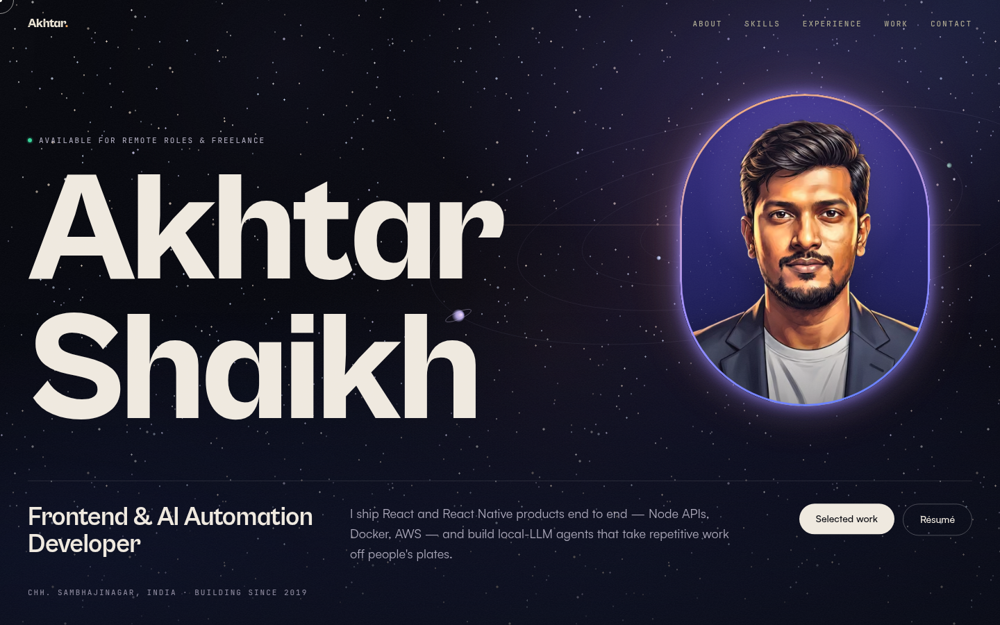

# Akhtar Shaikh — Portfolio

Personal portfolio of **Akhtar Shaikh**, Frontend & AI Automation Developer (React · React Native · Node · Docker · AWS · local LLMs).



## Stack
- **Vite + React + TypeScript + Tailwind CSS**, static build
- **GSAP + ScrollTrigger** and **Lenis** for motion (lazy-loaded chunk)
- **Supabase** (Postgres + Auth + Storage) as a headless CMS; the public site reads it via plain REST `fetch`, while the admin uses `@supabase/supabase-js` in a separate code-split chunk
- Self-hosted, subset fonts: **Cabinet Grotesk** (display), **Satoshi** (text), **JetBrains Mono** (labels)

## Features
- Preloader, split-text headline reveals, smooth scroll, pinned horizontal projects, infinite skills marquee
- Custom cursor and magnetic buttons (fine pointers only), hover previews on repos
- Canvas solar system in the hero and a site-wide CSS starfield (drifting depths, twinkle, shooting stars)
- Illustrated portrait in a glowing capsule; section-tinted backdrops; film grain
- Performance safeguards: transform/opacity-only animation, offscreen/hidden-tab pause, reduced-motion fallbacks, lighter effects on touch devices
- Lighthouse (local): mobile ~92 perf / 100 a11y / 100 best practices / 100 SEO

## Admin (CMS)
`/admin` lets the owner edit the hero, about, skills, experience, projects (drag-to-reorder, featured toggle, cover uploads, links), contact/socials, résumé PDF, portrait and SEO.

One-time setup:
1. Supabase → Authentication → URL Configuration: set **Site URL** to the live domain and add `<domain>/admin` (and `http://localhost:4173/admin`) to Redirect URLs.
2. Open `/admin` → "First time? Create the owner account" with `akhtarshaikh0299@gmail.com` and a strong password, confirm the email, then sign in.
3. Only that email can sign up (database trigger) or write (Row Level Security). Optionally disable new sign-ups afterwards.

Schema and policies: see `supabase/README-schema.md` and `ADMIN.md`.

## Local development
```bash
cp .env.example .env     # Supabase URL + publishable (public) key
npm install
npm run dev              # http://localhost:5173
npm run build && npx serve -s dist -l 4173
```
The publishable key is safe to expose; all writes are protected by RLS. `public/content.json` is an offline fallback snapshot of the CMS content.

## Scripts
- `scripts/seed.py`, `scripts/copy_v4.py` — content seed / SQL
- `scripts/gen_images.py` — procedural backgrounds, covers and OG image
- `scripts/portrait_ai.py` — portrait cleanup, cutout, rim light and web exports
